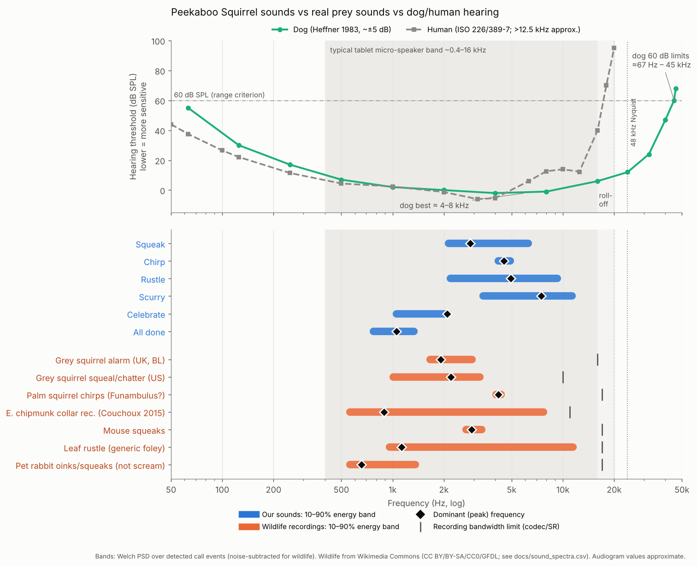

# Designing sounds for dogs (and tablet speakers)

## Dog hearing

| Hz | 63 | 125 | 250 | 500 | 1k | 2k | 4k | 8k | 16k | 24k | 32k | 45k |
|---|---|---|---|---|---|---|---|---|---|---|---|---|
| Dog threshold, dB SPL (Heffner 1983 *Behav Neurosci* 97:310, read from curve ±5 dB) | ~55 | ~30 | ~17 | ~7 | ~2 | ~0 | ~−2 | ~−1 | ~6 | ~12 | ~24 | ~60 |
| Human (ISO 226:2003; >12.5 kHz approx.) | 37.5 | 22.1 | 11.4 | 4.4 | 2.4 | −1.3 | −5.4 | 12.6 | ~40 | >100 | — | — |

* Dog range at 60 dB SPL ≈ 67 Hz – 45 kHz; most sensitive ≈ 4–8 kHz (Heffner 1983; Lipman & Grassi 1942
  via Fay 1988). Dogs are much more sensitive than people above ~8 kHz.
* A budget tablet micro-speaker realistically plays ~0.4–16 kHz (typical, not measured on your device),
  and a 48 kHz audio path ends at 24 kHz. So the *usable* overlap is ~0.5–12 kHz, and the sweet spot
  where dogs are most sensitive *and* the speaker is strong is ~2–8 kHz.
* **Ultrasound (>20 kHz, dog-only) is not worth it**: tablets can't emit much energy there and
  18–20 kHz can bother children.

## Real prey sounds (measured, CC recordings — see `sound_spectra.csv`)

Grey squirrel alarm/chatter ~1–3.4 kHz dominant ~2 kHz (harmonics to ~10 kHz); palm squirrel chirps
~4.2 kHz; mouse squeaks ~2.7–3.3 kHz; eastern chipmunk sounds ~0.6–7.7 kHz (chip sweeps ~9.6→2.8 kHz,
Burke da Silva et al. 1994 *Can J Zool*); leaf-litter rustle ~1–11.5 kHz. Barn owls localise prey rustles
best at 4–8 kHz (Konishi 1973). Caveat: recordings were codec-limited to 10–17 kHz.

## Our sounds: before → after retuning

| Sound | Before (10–90% energy) | After | Real reference |
|---|---|---|---|
| Squeak | 1.9–4.3 kHz | 2.1–6.3 kHz (stronger harmonics, sweep to 4.2 kHz) | squirrel alarm / mouse squeak |
| Chirp | 4.1–4.8 kHz | 4.2–4.9 kHz + 2nd harmonic at −12 dB | palm squirrel chirp 4.1–4.3 kHz |
| Rustle | 4.0–21.8 kHz (64% >10 kHz) | 2.2–9.3 kHz, peak ~5 kHz | leaf rustle 1–11.5 kHz |
| Scurry | 10–22.8 kHz (90% >10 kHz — near-silent on a tablet) | 3.4–11.3 kHz, ~1 kHz body | chipmunk/leaf contact 0.6–7.7 kHz |
| Celebrate | 1.1–2.1 kHz | unchanged | — |
| All done | 0.38–0.66 kHz (weak on micro-speakers) | 0.77–1.34 kHz (up an octave, still calm) | — |

`SynthTest` now enforces: ≥85% of every sound's energy in 0.5–12 kHz (speaker band), and ≥60% of each
prey cue's energy in 1.5–10 kHz (dog-sensitive, prey-like).

**Biggest uncertainty:** the actual speaker response. A measurement-mic sweep of the tablet would settle it.
